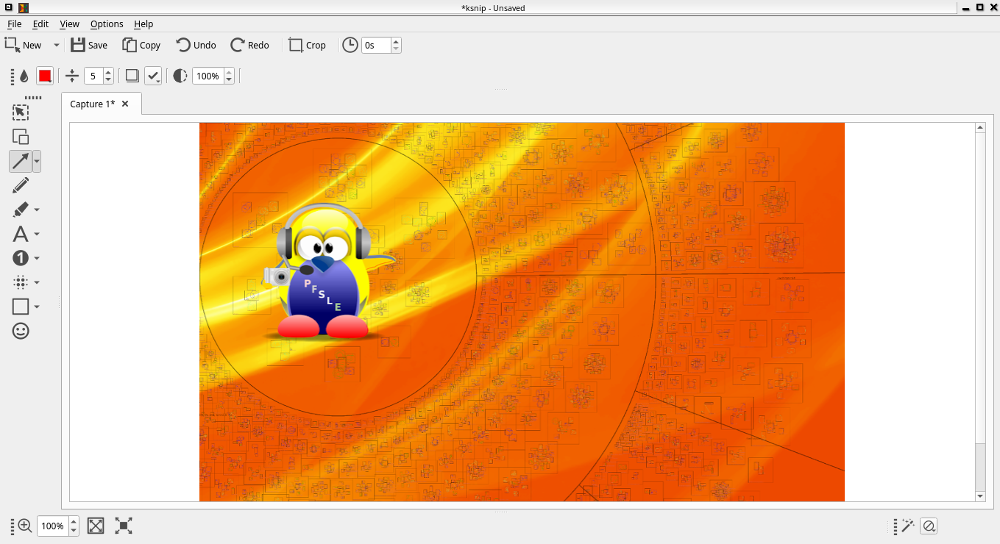
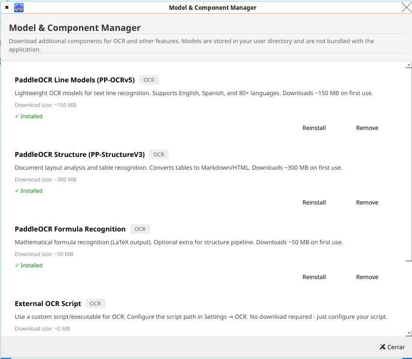

<div align="center">
  
  <h1>ksnip PyQt6 Port</h1>
  <p><strong>A modern Python/PyQt6 port of the ksnip screenshot and annotation application.</strong></p>
  <p>
    <a href="ROADMAP.md"></a>
    <a href="pyproject.toml"></a>
    <a href="pyproject.toml"></a>
    <a href="#linux-manual"></a>
  </p>
  <p>
    <a href="https://github.com/wachin/ksnip/releases/latest"></a>
    <a href="LICENSE.txt"></a>
    <a href="#contributing"></a>
    <a href="https://github.com/wachin/ksnip/issues"></a>
    <a href="https://github.com/wachin/ksnip/stargazers"></a>
  </p>
</div>

This repository ports [ksnip](https://github.com/ksnip/ksnip) from C++/Qt to
Python/PyQt6 while preserving its familiar workflow, icons, settings hierarchy,
editable annotations, and kImageAnnotator-inspired behavior. The active Python
implementation lives in `ksnip_py/`.

> [!IMPORTANT]
> ksnip_py is already usable for daily screenshot and annotation work, but it
> remains under active development and is not yet a finished replacement for
> upstream ksnip. Consult the [roadmap](ROADMAP.md) for the features that are
> still missing.

<p align="center">
  
</p>

## Navigation

- [Installation manual: Linux, Windows, and macOS](#installation-manual-choose-one-operating-system)
- [Current features](#current-features)
- [Help wanted](#help-wanted)
- [Known gaps](#known-gaps)
- [Documentation](#documentation)
- [Linux dependency reference](#linux-dependency-reference)
- [Sticker collections and artwork sources](#sticker-collections-and-artwork-sources)
- [Editable projects and SVG](#editable-projects-and-svg)
- [Desktop theme integration](#desktop-theme-integration)
- [Command line](#command-line)
- [Keyboard shortcuts](#keyboard-shortcuts)
- [Zoom controls](#zoom-controls)
- [Text tool](#text-tool)
- [Optional OCR](#optional-ocr)
- [Project layout](#project-layout)
- [Development checks](#development-checks)
- [Port status](#port-status)
- [Building and packaging](#building-and-packaging)
- [Model Manager](#model-manager)
- [Contributing](#contributing)
- [License](#license)

## Installation manual: choose one operating system

This section is written for people who are installing ksnip_py for the first
time. Choose **only one** of the three manuals below. Do not mix the commands
from Linux, Windows, and macOS.

> [!IMPORTANT]
> Throughout these manuals:
>
> - **One-time step** means that you run it only during the first installation,
>   or after a major update.
> - **Every-time step** means that you run it each time you want to open
>   ksnip_py.
> - Commands are shown in boxes. Copy the complete line, paste it into the
>   terminal, and press Enter.
> - A terminal is the text window used to type commands. On Windows it is
>   called **PowerShell**.

| Operating system | Easiest method | Method for developers |
| --- | --- | --- |
| Ubuntu, Debian, MX Linux | [Debian package](#linux-manual) | [System PyQt6](#linux-system-python) or [pip + venv](#linux-pip-venv) |
| Windows 10 or 11 | [Windows installer](#windows-manual) | [Python 3.12 + venv](#windows-python-venv) |
| macOS | [macOS application bundle](#macos-manual) | [Python 3.12 + venv](#macos-python-venv) |

---

<a id="linux-manual"></a>

# Manual 1: Linux (Ubuntu, Debian, MX Linux)

There are three ways to install ksnip_py on Linux. **Most users should choose
Option A.** Developers and users who need Python-only dependencies such as
PaddleOCR can choose Option B or Option C.

## Linux Option A: install the Debian package (recommended for most users)

The `.deb` package installs the application, its menu entry, its icon, its
manual page, and its required Qt dependencies. The user does not need to
create a virtual environment or install Python packages with `pip`.

### One-time installation

| Step | When to do it |
| --- | --- |
| Download the `.deb` and run `sudo apt install` | One time |
| Open the menu entry or run `ksnip-pyqt6` | Every time |

1. Open the [latest release](https://github.com/wachin/ksnip/releases/latest)
   in a web browser.
2. Download the file whose name starts with `ksnip-pyqt6_` and ends with
   `_all.deb`.
3. Open the **Downloads** folder.
4. Open a terminal in that folder: right-click the folder background and choose
   **Open Terminal** (the exact wording depends on the file manager).
5. Install the package. The `*` means "use the downloaded file":

   ```bash
   sudo apt install ./ksnip-pyqt6_*.deb
   ```

6. Type your login password when `sudo` asks for it. The password is not shown
   while you type; this is normal. Press Enter.
7. If apt asks whether to continue, type `Y` and press Enter.

The package manager downloads or confirms the required dependencies itself.
You do not need to run `pip`, activate a virtual environment, or edit the
`PATH`.

### Every time you want to use it

Open **ksnip_py** from the application menu, or run:

```bash
ksnip-pyqt6
```

That is all. There is no environment to activate.

### Updating or removing the package

To update, download the newer `.deb` and install it with the same
`sudo apt install ./ksnip-pyqt6_*.deb` command. To remove it:

```bash
sudo apt remove ksnip-pyqt6
```

The package is intended for Debian 13, Ubuntu 24.04 or newer, and compatible
derivatives. On an older distribution, use the AppImage or the pip method
instead.

### Linux Option A2: AppImage (no installation)

If a `.deb` package is not suitable for your distribution, download the
AppImage from the same release page. It is a single executable file:

```bash
chmod +x ksnip-pyqt6-*.AppImage
./ksnip-pyqt6-*.AppImage
```

The `chmod` command is a one-time step. The `./...AppImage` command is the
every-time step. If the AppImage cannot start because FUSE is unavailable, run
it in extract-and-run mode:

```bash
./ksnip-pyqt6-*.AppImage --appimage-extract-and-run
```

## Linux Option B: use the distribution's PyQt6 packages

<a id="linux-system-python"></a>

This method runs the Python source directly with the PyQt6 supplied by Ubuntu
or Debian. It is the simplest source-based method and is recommended when you
do not need PaddleOCR or other pip-only packages.

### One-time installation

| Step | When to do it |
| --- | --- |
| Install apt packages, `git clone` | One time |
| `cd` and `python3 -m ksnip_py` | Every time |

1. Install the required system packages:

   ```bash
   sudo apt update
   sudo apt install python3-pyqt6 python3-pyqt6.qtsvg \
       qt6-translations-l10n libxcb-cursor0
   ```

   If `git` is not installed yet:

   ```bash
   sudo apt install git
   ```

2. Download the project:

   ```bash
   git clone https://github.com/wachin/ksnip.git
   cd ksnip
   ```

   If you do not want to use Git, download the repository ZIP from GitHub,
   extract it, and open a terminal inside the extracted `ksnip` folder.

### Every time you want to use it

```bash
cd ~/ksnip
python3 -m ksnip_py
```

Replace `~/ksnip` with the folder where you downloaded the project. There is
no virtual environment to activate and no `pip install` step.

### Optional packages for this method

These are not required just to start the program:

```bash
sudo apt install hunspell hunspell-en-us hunspell-es \
    x11-utils xdotool xdg-desktop-portal xdg-desktop-portal-gtk

sudo apt install qt6ct qt-style-kvantum qt-style-kvantum-l10n \
    adwaita-qt6 papirus-icon-theme breeze-icon-theme
```

- `hunspell` enables the integrated spell checker.
- `x11-utils` and `xdotool` improve active-window and window-under-cursor
  capture on X11.
- The portal packages enable screenshot capture on Wayland desktops.
- `qt6ct`, Kvantum, and Adwaita are optional appearance packages. They are
  needed for the **System** theme to follow the desktop light/dark setting;
  the built-in **Light** and **Dark** themes work without them.

## Linux Option C: pip inside a virtual environment

<a id="linux-pip-venv"></a>

Use this method if you are developing ksnip_py, need pip-only packages such as
PaddleOCR, or want an isolated Python environment. **Never use `sudo pip` and
never use `--break-system-packages` on Ubuntu or Debian.**

A virtual environment is a private Python folder named `.venv`. It keeps the
program's packages separate from the operating system.

### One-time installation

| Step | When to do it |
| --- | --- |
| Install apt packages, create `.venv`, run `pip install` | One time |
| `source .venv/bin/activate` and start the app | Every time |

1. Install the system packages needed to create the environment and run Qt:

   ```bash
   sudo apt update
   sudo apt install python3-pyqt6 python3-pyqt6.qtsvg \
       python3-venv python3-pip git \
       qt6-translations-l10n libxcb-cursor0
   ```

2. Download the project and enter its folder:

   ```bash
   git clone https://github.com/wachin/ksnip.git
   cd ksnip
   ```

3. Create the virtual environment:

   ```bash
   python3 -m venv .venv
   ```

   If you want Qt to use the distribution's qt6ct/Kvantum theme, create it with
   access to the system packages instead:

   ```bash
   python3 -m venv --system-site-packages .venv
   ```

4. Activate the environment:

   ```bash
   source .venv/bin/activate
   ```

   The prompt normally changes to show `(.venv)`. This means the private
   environment is active.

5. Install ksnip_py and its Python dependencies:

   ```bash
   python -m pip install --upgrade pip setuptools wheel
   python -m pip install -e .
   ```

   If you created the environment with `--system-site-packages` and want to use
   the system PyQt6 instead of downloading another copy, use:

   ```bash
   python -m pip install -e . --no-deps
   ```

6. Optional: install the OCR dependencies. This downloads hundreds of
   megabytes and is not required for normal screenshots:

   ```bash
   python -m pip install -r requirements-ocr.txt
   ```

### Every time you want to use it

You must activate the environment and then start the program:

```bash
cd ~/ksnip
source .venv/bin/activate
ksnip-pyqt6
```

Alternatively, use the virtual environment's Python directly without
activation:

```bash
~/ksnip/.venv/bin/python -m ksnip_py
```

To leave the environment in a terminal, run:

```bash
deactivate
```

The command `source .venv/bin/activate` is **not** needed if you use the
direct `.venv/bin/python` command.

### Linux dependency reference

| Package | Why it is needed |
| --- | --- |
| `python3-pyqt6` | Qt 6 Python bindings. |
| `python3-pyqt6.qtsvg` | SVG image support used by icons and stickers. |
| `qt6-translations-l10n` | Translations for Qt's own Open/Save dialogs and standard buttons. |
| `libxcb-cursor0` | Required by Qt's X11 backend on many Ubuntu/Debian systems. |
| `hunspell` + dictionary | Optional spell checking. |
| `x11-utils`, `xdotool` | Optional X11 active-window capture helpers. |
| `xdg-desktop-portal` + backend | Optional Wayland screenshot support. |
| `qt6ct` | Optional configuration tool for the **System** light/dark theme. |
| `qt-style-kvantum`, `qt-style-kvantum-l10n` | Optional Kvantum dark style for qt6ct. |
| `adwaita-qt6` | Optional Adwaita/Adwaita-Dark style for qt6ct. |

### Linux troubleshooting

- **`ModuleNotFoundError: No module named 'PyQt6'`**
  Install `python3-pyqt6`, or make sure the correct virtual environment is
  active. With a virtual environment, run `python -m pip install -e .` again.

- **Qt complains about the `xcb` platform plugin**
  Install `libxcb-cursor0` and try again.

- **`error: externally-managed-environment`**
  You tried to install packages into the system Python. Do not use
  `--break-system-packages`. Use a virtual environment as shown above.

- **`No module named venv`**
  Install `python3-venv`.

- **`ksnip-pyqt6: command not found`**
  In a virtual environment, activate it first, or run
  `.venv/bin/python -m ksnip_py`. For the Debian package, reinstall the `.deb`.

- **Wayland capture does not open**
  Install `xdg-desktop-portal` and the backend recommended for your desktop.
  The application prints the detected desktop and a suggested package when
  portal capture fails.

---

# Manual 2: Windows 10 and Windows 11

<a id="windows-manual"></a>

There are two methods. **Option A is the easiest for non-developers.**
Option B is for developers, for users who want to run from source, or for users
who need an external OCR script.

## Windows Option A: install the ready-made application

1. Open the [latest release](https://github.com/wachin/ksnip/releases/latest).
2. Download the file whose name ends with `Windows-x64-setup.exe`.
3. Run the downloaded file.
4. Windows may show a blue **Windows protected your PC** message because the
   installer is not code-signed. Choose **More info**, then **Run anyway**.
5. Follow the installer. It installs for the current user and does not require
   administrator rights.
6. Start ksnip_py from the Start menu or the desktop shortcut.

This is a one-time installation. Every later launch is simply the Start-menu
shortcut; no Python, terminal, virtual environment, or `pip` command is needed.

> [!NOTE]
> A ZIP portable build is also published. Extract the ZIP and run
> `ksnip-pyqt6.exe` inside its folder. Do not run an executable directly from
> inside the ZIP file.

## Windows Option B: Python 3.12 + virtual environment

<a id="windows-python-venv"></a>

Use this method for development or when you need pip packages. The recommended
Python version is **Python 3.12, 64-bit**. Python 3.12 is the version with the
best compatibility with the optional PaddleOCR packages; Python 3.13 can fail
when installing PaddlePaddle on Windows.

### One-time installation

| Step | When to do it |
| --- | --- |
| Install Python 3.12, create `.venv`, run `pip install` | One time |
| Activate `.venv` and run `ksnip-pyqt6` | Every time |

#### 1. Install Python 3.12

1. Open <https://www.python.org/downloads/release/python-3120/> or the general
   Windows download page: <https://www.python.org/downloads/windows/>.
2. Download **Python 3.12.x — Windows installer (64-bit)**.
3. Run the installer.
4. On the first page, check **Add python.exe to PATH**. This is important.
5. Click **Install Now** and wait for it to finish.
6. Close the installer, then open a **new** PowerShell window. A PowerShell
   window that was already open will not see the new PATH.

Verify the installation:

```powershell
py -3.12 --version
python --version
```

Both commands should show a Python 3.12 version. If `python` opens the
Microsoft Store, use `py -3.12` in the remaining commands, or install Python
again with the PATH option enabled.

#### 2. Get the ksnip_py source

If Git is installed:

```powershell
cd $HOME
git clone https://github.com/wachin/ksnip.git
cd ksnip
```

If Git is not installed, download the GitHub ZIP, extract it, and open
PowerShell inside the extracted `ksnip` folder. In File Explorer, you can
right-click the folder background and choose **Open in Terminal** or
**Open PowerShell here**.

#### 3. Allow the virtual-environment activation script

PowerShell sometimes blocks the activation script with this message:

```text
running scripts is disabled on this system
```

Run this command once to allow locally created scripts for your user:

```powershell
Set-ExecutionPolicy -Scope CurrentUser -ExecutionPolicy RemoteSigned
```

Answer `Y` if PowerShell asks for confirmation. This is a one-time setting.
It does not require administrator rights.

#### 4. Create and prepare the virtual environment

```powershell
py -3.12 -m venv .venv
.\.venv\Scripts\Activate.ps1
python -m pip install --upgrade pip setuptools wheel
python -m pip install -e .
```

The prompt should show `(.venv)` after activation.

If `Activate.ps1` is still blocked, use Command Prompt (`cmd.exe`) for this
step:

```bat
.venv\Scripts\activate.bat
python -m pip install --upgrade pip setuptools wheel
python -m pip install -e .
```

#### 5. Start ksnip_py once

```powershell
ksnip-pyqt6
```

If Windows does not find that command, use the full path:

```powershell
.\.venv\Scripts\ksnip-pyqt6.exe
```

### Every time you want to use it

Open PowerShell and run:

```powershell
cd $HOME\ksnip
.\.venv\Scripts\Activate.ps1
ksnip-pyqt6
```

If you do not want to activate the environment, this single command is enough:

```powershell
$HOME\ksnip\.venv\Scripts\ksnip-pyqt6.exe
```

If you downloaded the ZIP instead of cloning, replace `$HOME\ksnip` with the
folder where you extracted it.

You can also right-click
`C:\Users\<your-name>\ksnip\.venv\Scripts\ksnip-pyqt6.exe`, choose **Send to →
Desktop (create shortcut)**, and launch it from the desktop. The path will
contain your actual Windows user name instead of `<your-name>`.

### Optional Windows components

- **OCR:** the easiest route is the separate Windows OCR guide:
  [Windows OCR setup](docs/WINDOWS_OCR_SETUP.md). It explains how to install
  Python 3.12, PaddleOCR, a wrapper script, and how to select the script in
  **Settings → OCR**.
- **Spell checking:** Hunspell is not bundled with the Windows installer.
  Without a Hunspell executable and dictionary on `PATH`, the application
  simply runs without spell checking.
- **Qt translations:** PyQt6 supplies the Qt runtime. The application's own 41
  language catalogs are included in the repository and package.

### Windows capture and feature limitations

The Qt-based capture modes (rectangular area, full screen, and current screen)
are available. Some Linux-specific helpers are not:

| Feature | Windows status |
| --- | --- |
| Rectangular area capture | Available through Qt |
| Full-screen and current-screen capture | Available through Qt |
| Active-window capture | Not implemented on Windows (X11-only helper) |
| Window-under-cursor capture | Not implemented on Windows (X11-only helper) |
| Automatic mouse-cursor capture | X11-only |
| `xdg-desktop-portal` | Linux-only |
| Built-in Light/Dark themes | Available |

If a Linux-only action fails, use rectangular or full-screen capture instead.
The application remains usable for opening, editing, annotating, saving, and
exporting existing images.

### Windows troubleshooting

- **`python` opens the Microsoft Store**
  Use `py -3.12` instead, or reinstall Python 3.12 with **Add python.exe to
  PATH** checked.

- **`running scripts is disabled on this system`**
  Run the `Set-ExecutionPolicy` command shown above once, then open a new
  PowerShell window.

- **`ksnip-pyqt6` is not recognized**
  Activate `.venv` first, or run
  `.\.venv\Scripts\ksnip-pyqt6.exe`.

- **PaddleOCR installation fails**
  Confirm that you are using 64-bit Python 3.12, not 3.13:

  ```powershell
  py -3.12 -c "import struct; print(struct.calcsize('P') * 8)"
  ```

  The result must be `64`. See the
  [Windows OCR setup](docs/WINDOWS_OCR_SETUP.md).

- **Windows Defender or SmartScreen warns about the installer**
  The installer is not code-signed. Use **More info → Run anyway** only if you
  downloaded it from this project's official GitHub release page. Build the
  program from source if your organization does not allow unsigned installers.

---

# Manual 3: macOS

<a id="macos-manual"></a>

The current prebuilt macOS application is distributed as a ZIP containing a
`.app` bundle. It is unsigned, so macOS Gatekeeper may warn on the first
launch. The source installation uses Python 3.12 and a virtual environment.

## macOS Option A: use the prebuilt application bundle

1. Open the [latest release](https://github.com/wachin/ksnip/releases/latest).
2. Download the file ending with `macOS-x86_64.zip`. The current build targets
   Intel Macs and macOS 14 or newer.
3. Double-click the ZIP to extract it.
4. Move `ksnip-pyqt6.app` to the **Applications** folder.
5. The first time, right-click the app and choose **Open**, then confirm
   **Open**. This is required because the bundle is not signed or notarized.
6. Grant Screen Recording permission when macOS asks. If it does not ask, open
   **System Settings → Privacy & Security → Screen Recording**, add
   `ksnip-pyqt6`, and restart the app.

This is a one-time installation. Every later launch is from Launchpad,
Spotlight, or the Applications folder.

> [!NOTE]
> The published macOS ZIP is an Intel build. Apple Silicon Macs can run it
> through Rosetta, or use the source installation below for a native arm64
> Python environment.

## macOS Option B: Python 3.12 + virtual environment

<a id="macos-python-venv"></a>

### One-time installation

| Step | When to do it |
| --- | --- |
| Install Python 3.12, create `.venv`, run `pip install` | One time |
| Activate `.venv` and run `ksnip-pyqt6` | Every time |

1. Install **Python 3.12, 64-bit**:
   - Recommended for most users: download the macOS installer from
     <https://www.python.org/downloads/release/python-3120/> and run it.
   - Homebrew users can run:

     ```bash
     brew install python@3.12
     ```

2. Verify Python:

   ```bash
   python3.12 --version
   ```

3. Install Git if it is not already available. Running this command may open
   the Apple developer-tools installer:

   ```bash
   xcode-select --install
   ```

   Alternatively, download the GitHub ZIP and extract it manually.

4. Download the project and enter its folder:

   ```bash
   cd ~
   git clone https://github.com/wachin/ksnip.git
   cd ksnip
   ```

5. Create the virtual environment:

   ```bash
   python3.12 -m venv .venv
   source .venv/bin/activate
   ```

6. Install ksnip_py:

   ```bash
   python -m pip install --upgrade pip setuptools wheel
   python -m pip install -e .
   ```

7. Start it once:

   ```bash
   ksnip-pyqt6
   ```

### Every time you want to use it

```bash
cd ~/ksnip
source .venv/bin/activate
ksnip-pyqt6
```

Without activation:

```bash
~/ksnip/.venv/bin/python -m ksnip_py
```

If you did not clone into your home folder, replace `~/ksnip` with the actual
project folder.

### macOS Screen Recording permission

macOS protects screen capture. On the first capture, macOS should ask for
permission. If the screenshot is black or empty, open:

**System Settings → Privacy & Security → Screen Recording**

Enable the application or the terminal program that launched it (Terminal,
iTerm2, or Visual Studio Code). Quit and reopen that program, then try again.

### macOS capture and feature limitations

The Qt-based rectangular, full-screen, and current-screen capture modes are
the supported ones. As on Windows, the active-window and window-under-cursor
helpers are X11/Linux-specific, and automatic mouse-cursor capture is
X11-only. The `xdg-desktop-portal` backend is Linux-only.

### Optional macOS components

- **Spell checking:** install Hunspell with Homebrew if you want it:

  ```bash
  brew install hunspell
  ```

  Without Hunspell and a dictionary, the editor works normally but does not
  underline misspelled words.

- **OCR:** use an external OCR script and select it in **Settings → OCR**.
  PaddleOCR availability depends on the packages published for your Mac and
  Python version; the source installation does not guarantee a working
  PaddlePaddle wheel on every macOS release.

### macOS troubleshooting

- **The app cannot be opened because the developer cannot be verified**
  Right-click the `.app`, choose **Open**, then **Open** again. This is
  expected for the unsigned build.

- **Captured images are black or empty**
  Grant Screen Recording permission as described above, then restart the
  terminal or the application.

- **`python3.12: command not found`**
  Reinstall Python 3.12 from python.org, or use the full path printed by the
  installer. With Homebrew, check `brew --prefix python@3.12`.

- **`No module named PyQt6`**
  Activate `.venv` and run `python -m pip install -e .` again.

---

## After installation: a quick health check

These commands should print a version number and then exit:

```bash
ksnip-pyqt6 --version
```

When running from a source checkout without an installed command:

```bash
python3 -m ksnip_py --version
```

If the command starts the graphical application instead, that is also a
successful installation. Close the window normally.

The built-in **Light** and **Dark** themes need no extra packages on any of the
three operating systems. Linux users who want the **System** theme to follow
qt6ct/Kvantum should read [Desktop theme integration](#desktop-theme-integration)
and the [Qt ABI note](#important-qt-abi-requirement).

## Help wanted

Developers, testers, designers, Debian packagers, and translators are welcome. The most useful areas for contributions are:

- Wayland and `xdg-desktop-portal` capture support.
- Native global hotkeys.
- Fine visual parity with the original toolbar, editor, and settings dialog.
- Remaining kImageAnnotator behavior and effects.
- Imgur, FTP, and plugin-system parity.
- Automated GUI tests.
- Packaging for other distributions (RPM, AppImage, Flatpak) and review of the
  Debian package.

See [ROADMAP.md](ROADMAP.md) for the detailed implementation status and reference screenshots.

## Current features

- Rectangular, last-area, full-screen, current-screen, active-window, and window-under-cursor capture modes.
- Optional real X11 cursor capture through XFixes; off by default, requires a capture delay, blinks a yellow marker around the pointer and adds the cursor as a movable fixed-size item. A standard arrow is used by default; the actual pointer shape (such as the text I-beam) is optional. Toggle it from New Screenshot → Include Mouse Cursor.
- Capture delay, implicit delay, startup capture, auto-copy, and auto-save preferences.
- Open and Save dialogs remember their own window size and position across sessions.
- System, Light, and Dark theme choices under View → Theme; switching applies immediately, and the built-in dark palette works on Linux, Windows, and macOS.
- Open, paste, embedded paste, save, save as, save all, rename, delete, print, and print preview.
- Editable `.ksnip` project files and SVG export for continued editing in Inkscape.
- Multiple image tabs with dirty-state tracking and dynamic window titles.
- Recent images, containing-directory access, path copying, and Data URI copying.
- Annotation tools for selection, pen, markers, lines, arrows, shapes, text, numbers, blur, pixelate, stickers, and crop.
- Inline multiline text editing with re-editing and Hunspell-backed spelling suggestions.
- Multiple selection, move, resize, duplicate, ordering, copy/paste, undo, and redo.
- Rotate, scale, crop, and modify-canvas operations.
- Zoom from 10% to 800% using toolbar controls, keyboard shortcuts, fit-to-window, or `Ctrl` + mouse wheel.
- Watermarks and always-on-top pin windows.
- Script uploader and optional PaddleOCR/script OCR backends.
- System tray workflow and configurable application shortcuts.
- Hierarchical settings dialog modeled after the original C++ application.
- Command-line image opening, standard-input images, capture-mode selection, direct saving, cursor capture, and script upload.
- Generic `xdg-desktop-portal` capture with desktop/session diagnostics and backend recommendations.
- Ten sticker collections with persistent favorites and last-tab restoration, including user-imported images.

## Known gaps

- Live capture validation across X11, Wayland, mixed-DPI systems, and different portal backends.
- Native OS-global hotkey registration.
- Complete C++ plugin-system parity.
- Native Imgur and FTP uploaders. The deferred Imgur design and API registration requirements are documented in [`docs/imgur/README_ES.md`](docs/imgur/README_ES.md).
- Complete startup, tray-menu, and OCR modeless-window parity with the C++ application.
- Exact visual and behavioral parity across every editor control.
- Automated GUI coverage.

## Documentation

| Topic   | Document |
| --- | --- |
| Port status and priorities | [ROADMAP.md](ROADMAP.md) |
| C++ to PyQt6 parity matrix | [PARITY_MATRIX.md](docs/PARITY_MATRIX.md) |
| Capture backends and Wayland | [Capture backend parity](docs/CAPTURE_BACKEND_PARITY.md) |
| Command-line compatibility | [CLI parity](docs/CLI_PARITY.md) |
| Unicode QFileDialog bookmarks and Qt translations | [File dialogs](docs/FILE_DIALOGS.md) |
| Global shortcut integration | [Global hotkeys](docs/GLOBAL_HOTKEYS.md) |
| Annotation-tool behavior | [kImageAnnotator tool parity](docs/KIMAGEANNOTATOR_TOOL_PARITY.md) |
| Startup and single-instance behavior | [Startup lifecycle parity](docs/STARTUP_LIFECYCLE_PARITY.md) |
| Building distributions and CI workflows | [GitHub Actions and packaging guide (Spanish)](docs/GITHUB_ACTIONS_PACKAGES_ES.md) |
| OCR installation on Debian derivatives | [PaddleOCR guide (Spanish)](docs/OCR_PADDLEOCR_ES.md) |
| OCR plugin architecture and Debian packaging rationale | [OCR plugin architecture](docs/OCR_PLUGIN_ARCHITECTURE.md) |
| Translation review and current catalog gaps | [Translation audit](docs/TRANSLATION_AUDIT.md) |
| Script uploader verification | [Script uploader tests (Spanish)](docs/PRUEBAS_UPLOADER_SCRIPT_ES.md) |
| Deferred Imgur implementation | [Imgur port notes (Spanish)](docs/imgur/README_ES.md) |
| Debian packaging and policy compliance | [debian/](debian/) |

## Themes

Choose **View → Theme** to select:

- **System:** follows the platform theme. On Linux this can be qt6ct with a
  Kvantum or Adwaita dark style; on Windows and macOS it follows the native
  system theme.
- **Light:** built-in Fusion light palette and light icons.
- **Dark:** built-in Fusion dark palette and light-on-dark icons.

The choice is saved in `application/theme` and is applied immediately, including
a reload of the matching light/dark icons. The built-in Light and Dark choices
work on Linux, Windows, and macOS without extra packages. **System** follows
the native color scheme and updates when Qt reports a system color-scheme
change.

### System light/dark theme on Linux with qt6ct

`qt6ct` is the Qt 6 configuration tool that tells Qt applications which style
and icon theme to use. Applications such as **Krusader** and **Gwenview** use
it to follow the light or dark theme selected in the desktop environment.
ksnip_py uses the same configuration when **View → Theme → System** is
selected. The built-in **Light** and **Dark** themes do not require qt6ct.

Install qt6ct and the two dark Qt styles used in Debian 13:

```bash
sudo apt update
sudo apt install qt6ct qt-style-kvantum qt-style-kvantum-l10n adwaita-qt6
```

The icon packages are optional but make the dark theme look complete:

```bash
sudo apt install papirus-icon-theme breeze-icon-theme
```

Open `qt6ct` from the application menu or run:

```bash
qt6ct
```

In the **Appearance** page, choose one of the dark styles:

- **Style:** `Kvantum-Dark` (provided by `qt-style-kvantum`)
- **Style:** `Adwaita-Dark` (provided by `adwaita-qt6`)
- **Icon theme:** `Papirus-Dark` or `Breeze-Dark`

In Debian 13, these are the two dark Qt styles used for this setup. For a
light theme, choose the corresponding light style, or simply use ksnip_py's
built-in **View → Theme → Light**.

After applying the configuration, start ksnip_py and select **View → Theme →
System**. Before creating the QApplication, ksnip_py selects
`QT_QPA_PLATFORMTHEME=qt6ct` automatically when the qt6ct plugin is present in
the active Qt plugin path. An explicit `gtk3`, `kde`, or similar
platform-theme choice is respected.

The exact capitalization in qt6ct can vary slightly between versions; the
entries are the Kvantum and Adwaita dark variants shown in the style list.

### Important Qt ABI requirement

qt6ct and Kvantum are built against the distribution's Qt version. On Debian 13
that is Qt 6.8, while a pip PyQt6 wheel may bundle a newer Qt (for example
6.11). A newer PyQt6 wheel cannot load the distribution's qt6ct/Kvantum plugins.

For the dark theme, use the Debian package or the system PyQt6. If you need a
virtual environment, create it with access to the system packages and do not
install the pip PyQt6 wheel:

```bash
python3 -m venv --system-site-packages .venv
source .venv/bin/activate
python -m pip install -e . --no-deps
```

If ksnip_py runs with a pip-only PyQt6 wheel, it still works, but qt6ct,
Kvantum, and Adwaita from the distribution are ignored by Qt because of the ABI
mismatch.

### Windows and macOS

`qt6ct`, Kvantum, Papirus, and Breeze are Linux packages. On Windows and macOS
there is no `qt6ct` equivalent to install, and the Linux packages above do not
apply. Use **View → Theme → Dark** for the built-in dark palette; **System**
follows the native operating-system theme.

## Sticker collections and artwork sources

The sticker selector provides ten tabs: Original, Papirus, GNOME, Numix, SuperTux, TuxBaby, Konqi & Katie, Geeko, GNU Baby, and User. The bundled themes use high-resolution sources, exclude symbolic-link duplicates, remember the last tab, and preserve pinned favorites across theme changes and application restarts. The User tab imports common image formats, preserves transparency and aspect ratio, converts them to PNG with a maximum dimension of 512 px, and stores them in the application's configuration directory; that directory can also be opened directly in the file manager. Copyright notices and licenses for bundled artwork are documented in `THIRD_PARTY_LICENSES.md` and `ksnip_py/licenses/`.

The TuxBaby collection is © 2026 Washington Indacochea Delgado and licensed under CC BY-SA 4.0. It was generated under his creative direction with assistance from ChatGPT's image-generation capabilities and is inspired by Tux, created by Larry Ewing using The GIMP. See `ksnip_py/licenses/TUXBABY_LICENSE.md` for the complete attribution and license notice.

The unofficial Konqi and Katie sticker collection is © 2026 Washington Indacochea Delgado and licensed under CC BY-SA 4.0. It was generated under his creative direction with assistance from ChatGPT and is based on KDE's Konqi and Katie mascot designs by Tyson Tan. See `ksnip_py/licenses/KONQI_KATIE_LICENSE.md` for attribution, licensing, and trademark notices.

The unofficial Geeko sticker collection is © 2026 Washington Indacochea Delgado and licensed under CC BY-SA 4.0. It was generated under his creative direction with assistance from ChatGPT and is based on Geeko, the SUSE and openSUSE chameleon mascot. See `ksnip_py/licenses/GEEKO_LICENSE.md` for attribution, licensing, and trademark notices.

The unofficial GNU Baby sticker collection is © 2026 Washington Indacochea Delgado and licensed under CC BY-SA 2.0. It was generated under his creative direction with assistance from ChatGPT and is inspired by the GNU Head created by Etienne Suvasa. See `ksnip_py/licenses/GNUBABY_LICENSE.md` for attribution, licensing, and the GNU trademark notice.

Large contact sheets and other working artwork are kept under
`artwork-sources/`, outside the installed Python package. Reproducible
extractors under `tools/` generate the optimized 256×256 transparent PNGs used
by the application. See `artwork-sources/README.md` for the exact commands.

## Editable projects and SVG

Choose `File > Save As... > Ksnip Project` to save a `.ksnip` project. The format is a ZIP container with `project.json` and `background.png`; it preserves editable annotations, embedded images and stickers, the image effect, zoom, and number-tool state. Opening the `.ksnip` file restores the editor rather than flattening the annotations.

Whenever a `.ksnip` project is saved, ksnip_py also updates a flattened image beside it with the same base name. PNG is used by default; choose PNG, JPEG, WebP, or BMP under `Settings > Saver > Image saved alongside Ksnip projects`.

New files use PNG as their primary save format by default. Under `Settings > Saver > Default save format`, users can switch the default between a flattened PNG image and an editable `.ksnip` project.

Choose `File > Export as SVG...` to create a document for Inkscape. The screenshot is embedded as PNG while supported annotations remain SVG vectors and text. Raster overlays are embedded as PNG. SVG is intended for interchange with vector editors; use `.ksnip` as the lossless working project format.

For `Number Arrow`, the properties toolbar controls the shaft thickness and arrowhead size independently. These values remain editable in `.ksnip` projects and are preserved during SVG export. Hover over a property control to see a short explanation of its purpose.

## Desktop theme integration

On GTK-based desktops, the following can help Qt use the desktop file-dialog and menu theme:

```bash
QT_QPA_PLATFORMTHEME=gtk3 python3 -m ksnip_py
```

## Command line

```text
ksnip-pyqt6 [IMAGE]
ksnip-pyqt6 --edit IMAGE
cat image.png | ksnip-pyqt6 --edit -
ksnip-pyqt6 --rectarea
ksnip-pyqt6 --lastrectarea
ksnip-pyqt6 --fullscreen
ksnip-pyqt6 --current
ksnip-pyqt6 --active
ksnip-pyqt6 --windowundercursor
ksnip-pyqt6 --portal
ksnip-pyqt6 --delay SECONDS --fullscreen
ksnip-pyqt6 --fullscreen --cursor
ksnip-pyqt6 --fullscreen --save
ksnip-pyqt6 --current --saveto /path/to/capture.png
ksnip-pyqt6 --current --upload
ksnip-pyqt6 --fullscreen --save --upload
```

Use `ksnip-pyqt6 --help` for the current option list. `--upload` uses the script configured under `Settings > Uploader > Script Uploader`. On Wayland, `--portal` delegates capture selection to `xdg-desktop-portal`.

All command-line options from the C++ implementation are supported. The
detailed C++ → PyQt6 option audit, intentional extensions, and corrected
legacy parser defects are recorded in `docs/CLI_PARITY.md`.

Wayland sessions are detected automatically and regular capture actions are redirected through `xdg-desktop-portal`. `Settings > Image Grabber > Force Generic Wayland` applies the same behavior manually, including on X11. Full-screen capture is requested non-interactively; the other capture modes use the portal's interactive chooser.

`Scale Generic Wayland Screenshots` applies the primary screen's Qt device-pixel ratio to the portal image without resampling its pixels, matching the C++ implementation. Because the screenshot portal does not identify the source monitor, mixed-DPI systems may need this option left disabled. The capture backend audit and live-validation matrix are documented in `docs/CAPTURE_BACKEND_PARITY.md`.

The shortcuts edited under `Settings > HotKeys` are application shortcuts and work while ksnip is active. For reliable system-wide shortcuts on both X11 and Wayland, configure the desktop or window manager to execute ksnip's command-line capture actions. Suggested commands and the native-hotkey design decision are documented in `docs/GLOBAL_HOTKEYS.md`.

Single-instance mode is enabled by default and can be changed under `Settings > Application`. Additional invocations forward their command-line arguments to the existing process through a per-user Qt local socket, allowing it to show the editor, open an image, or perform a capture without starting a second GUI instance.
Images supplied through standard input are forwarded as image bytes when another instance is already running.

The PyQt6 port loads Qt Linguist `.qm` catalogs using the language selected under `Settings > Application > Language`, or the system locale by default. Use `--language LOCALE` (for example, `--language es`, `de`, `pt_BR` or `zh_Hant`) for a temporary command-line override. The language selector is generated from the 41 catalogs shipped with the package. Missing messages safely fall back to English.

The official `qtbase_*.qm` catalog is loaded separately for standard Qt6
widgets, including the Open and Save dialogs. On Linux the distribution
translation paths from `qt6-translations-l10n` are preferred; the Qt runtime's
`QLibraryInfo.TranslationsPath` is the fallback. See `docs/FILE_DIALOGS.md` for
the Unicode bookmark diagnosis, dialog geometry, and Windows/macOS deployment
behavior.

Compatible strings from the original C++ `ksnip` catalogs are reused by the port. The `ksnip_py` catalog contains messages that only exist in the Python implementation.

### Translation workflow and review

Install the Qt translation tools:

```bash
sudo apt install linguist-qt6 qt6-l10n-tools pyqt6-dev-tools
```

The packages provide:

- `linguist6`: Qt Linguist, the graphical `.ts` editor;
- `lrelease`: compiles `.ts` files into `.qm`;
- `pylupdate6`: extracts translatable strings from the Python sources.

Open a catalog for review:

```bash
linguist6 ksnip_py/translations/ksnip_py_es.ts
```

In Qt Linguist, review the source and target columns, complete unfinished
messages, and check that placeholders such as `%1` are preserved. Do not
translate product names or technical identifiers such as `PaddleOCR`,
`PaddlePaddle`, `PaddleX`, `PP-OCRv5`, `PP-StructureV3`, or
`PP-FormulaNet_plus-L`.

To synchronize the catalogs after changing Python strings, run:

```bash
python3 tools/update_pyqt_translations.py
```

The script extracts the Python messages, carries over the existing
`ksnip_py` translations (and, when present, matching entries from the
original C++ catalogs), and compiles every `.qm` file. To compile one catalog
manually:

```bash
lrelease ksnip_py/translations/ksnip_py_es.ts \
  -qm ksnip_py/translations/ksnip_py_es.qm
```

`python3 tools/update_pyqt_translations.py` is the supported way to refresh
all 41 catalogs at once. Some catalogs still contain unfinished messages;
Qt Linguist shows them in the "Unfinished" filter and Qt falls back to the
English source text only for those messages.

## Keyboard shortcuts

The tables below list the defaults on Linux. Standard Qt shortcuts may follow
the native convention of another operating system. Shortcuts in the first
table can be changed or disabled under `Settings > HotKeys`; the remaining
application and tool shortcuts are currently fixed.

### Configurable application shortcuts

| Action | Default shortcut |
| --- | --- |
| Capture rectangular area | `Ctrl+Shift+R` |
| Capture last rectangular area | `Ctrl+Shift+L` |
| Capture full screen | `Ctrl+Shift+F` |
| Capture current screen | `Ctrl+Shift+S` |
| Capture active window | `Ctrl+Shift+A` |
| Capture window under cursor | `Ctrl+Shift+U` |
| Capture through the desktop portal | `Alt+Shift+T` |
| Open image or project | `Ctrl+O` |
| Save | `Ctrl+S` |
| Paste image | `Ctrl+V` |
| Pin current image | `Ctrl+Shift+P` |
| Add watermark | `Shift+W` |
| Upload | `Ctrl+Shift+U` |
| OCR text recognition | `Ctrl+Shift+T` |

`Capture window under cursor` and `Upload` currently share the same default
`Ctrl+Shift+U`. Assign a different combination to one of them in
`Settings > HotKeys` if both actions are enabled.

### File, editing, and view shortcuts

| Action | Shortcut |
| --- | --- |
| Save as | `Ctrl+Shift+S` |
| Print | `Ctrl+P` |
| Copy composed image | `Ctrl+C` |
| Close current tab | `Ctrl+W` |
| Rename current image | `F2` |
| Undo | `Ctrl+Z` |
| Redo | `Ctrl+Shift+Z` |
| Paste embedded image | `Ctrl+Shift+V` |
| Paste copied annotation item | `Ctrl+Alt+V` |
| Copy selected annotation item | `Ctrl+Shift+C` |
| Delete selected annotation item | `Delete` |
| Duplicate selected annotation item | `Ctrl+D` |
| Show or hide docks | `Tab` |
| Open recent image 1–9 | `Ctrl+1` through `Ctrl+9` |

### Annotation tool shortcuts

These single-key shortcuts select an annotation tool while the main editor has
focus.

| Tool | Key | Tool | Key |
| --- | --- | --- | --- |
| Select | `S` | Duplicate area | `U` |
| Arrow | `A` | Double arrow | `D` |
| Line | `L` | Pen | `P` |
| Marker pen | `M` | Marker rectangle | `J` |
| Marker ellipse | `K` | Rectangle | `R` |
| Ellipse | `E` | Text | `T` |
| Text pointer | `C` | Text arrow | `H` |
| Number | `N` | Number pointer | `O` |
| Number arrow | `W` | Blur | `B` |
| Pixelate | `X` | Sticker | `I` |

### Zoom and pointer shortcuts

| Action | Shortcut |
| --- | --- |
| Zoom in | `Ctrl++` |
| Zoom out | `Ctrl+-` |
| Reset zoom to 100% | `Ctrl+0` |
| Fit image to the available view | `Ctrl+F` |
| Zoom with the mouse or touchpad | `Ctrl` + vertical scroll |
| Add or remove an item from a multiple selection | `Ctrl` + left click |
| Edit a text item | Double-click the selected text item |

### Inline text editor shortcuts

| Action | Shortcut |
| --- | --- |
| Accept the text | `Ctrl+Enter` |
| Cancel a new edit | `Esc` |
| Insert a line break | `Enter` or `Shift+Enter` |
| Undo while editing | `Ctrl+Z` |
| Redo while editing | `Ctrl+Shift+Z` |

## Zoom controls

The canvas supports zoom levels from 10% to 800%:

- Hold `Ctrl` and scroll the mouse wheel up to zoom in by 10%.
- Hold `Ctrl` and scroll the mouse wheel down to zoom out by 10%.
- Scrolling without `Ctrl` continues to move normally through a large image.
- The status-bar buttons, percentage selector, standard zoom keyboard shortcuts,
  reset action, and fit-to-window action remain available.
- Touchpads are supported when they provide vertical pixel-scroll events.

## Text tool

1. Select `Text`.
2. Drag a rectangle on the screenshot.
3. Type directly in the inline editor.
4. Press `Ctrl+Enter` to accept or `Esc` to cancel a new text item.
5. Double-click an existing text item, or use `Edit text`, to edit it again.

Hunspell automatically detects installed dictionaries, underlines misspelled words, and provides replacement suggestions in the context menu.

## Optional OCR

OCR is optional and does not prevent the application from starting when
PaddleOCR is unavailable. The integrated PaddleOCR backend is validated on the
reference Linux environment below; a script backend can also be configured in
Settings.

### Model Manager

**Options → Model Manager…** provides a graphical interface to download OCR
models and other optional components on demand. Models are cached in the user's
application data directory and reused across sessions.



| Component | Size | Description |
| --- | --- | --- |
| PaddleOCR Line Models | ~150 MB | Text line recognition (80+ languages) |
| PaddleOCR Structure | ~300 MB | Layout analysis, table recognition, Markdown export |
| PaddleOCR Formula | ~50 MB | Mathematical formula recognition (LaTeX) |
| External OCR Script | 0 MB | User-provided script/executable |
| Spellcheck Dictionaries | ~50 MB | Hunspell dictionaries for text annotations |

Click **Install** next to any component to download and configure it. This
works from a source checkout. The frozen Windows and macOS artifacts do not
bundle OCR or a Python interpreter: in those builds `sys.executable` is the
application itself, so the pip-based installer cannot run and the dialog is
informational. Use a source install or an external OCR script there.

For a complete Windows walkthrough — installing Python 3.12 in PATH, creating a
dedicated virtual environment, installing PaddleOCR, and connecting a `.bat`
wrapper to **Settings → OCR → Script** — see
[Windows OCR setup](docs/WINDOWS_OCR_SETUP.md).

### Tested Linux OCR environment

The integrated PaddleOCR backend has been successfully tested on the following
reference system:

| Component | Tested version |
| --- | --- |
| Distribution | AV Linux MXe (`AVL-MXe 25.2 Ease`), from the MX Linux 25 family |
| Debian base | Debian GNU/Linux 13.6 (`trixie`) |
| Architecture | x86_64 |
| Python (system and virtual environment) | 3.13.5 |
| PyQt6 | 6.11.0 |
| Qt runtime | 6.11.0 |
| PaddleOCR | 3.7.0 |
| PaddlePaddle | 3.3.1 |
| Protobuf | 3.20.2 |

This is the known-working reference configuration used to implement and test
OCR. It is expected to work on comparable Debian 13 and derivative systems,
including compatible MX Linux, AV Linux, Ubuntu, and Linux Mint releases, when
the same Python OCR dependencies are available. Those other distributions and
versions should be treated as compatible candidates rather than as tested
configurations until somebody reports a successful test.

On Debian and derivatives, the supported installation method for PaddleOCR is
a Python virtual environment. Do not install it with `sudo pip` or
`--break-system-packages`. Create and prepare the environment once:

```bash
python3 -m venv .venv
source .venv/bin/activate
python -m pip install --upgrade pip setuptools wheel
python -m pip install -e .
python -m pip install -r requirements-ocr.txt
```

The requirements file pins Protobuf to the version currently compatible with
PaddlePaddle. Newer Protobuf releases can make PaddleOCR fail while loading its
generated descriptors and can then leave `paddle` partially initialized until
the application is restarted.

On its first use PaddleOCR downloads its models into the user's PaddleX cache,
so the initial recognition takes longer and needs network access. Later runs
reuse those files. ksnip_py disables oneDNN for this tested CPU configuration
and omits document-orientation models that are unnecessary for screenshots.

## pip launchers to ksnip_py with OCR

For later sessions, you can use one of the included launchers located in the
root directory of the repository. Both launchers select `.venv/bin/python`
automatically, eliminating the need to manually run `source .venv/bin/activate`
or `deactivate`:

- **`ksnip_py-run-ocr_check-first.sh`**: Verifies that the virtual environment
  and PaddleOCR are correctly installed before starting. This is useful for
  first-time runs or troubleshooting, though the import check adds a few seconds
  to the startup time.
- **`ksnip_py-run-ocr_without-check.sh`**: Skips the verification steps and
  launches `ksnip_py` instantly. Use this for daily use once you have confirmed
  that OCR is working correctly.

The launchers do not install packages automatically; the initial virtual
environment setup is still required. Detailed Spanish instructions, command
line examples, and support for a custom environment location are available in
[`docs/OCR_PADDLEOCR_ES.md`](docs/OCR_PADDLEOCR_ES.md).

> **🧠 Note: Why don't the launchers require `deactivate`?**
> If you are used to the terminal workflow (`source .venv/bin/activate`), you
> might worry that using these scripts leaves the virtual environment "active"
> in the background, requiring a manual `deactivate`.
> **There is no need to worry.** The scripts bypass shell activation entirely
> by calling the virtual environment's Python binary directly (`.venv/bin/python`).
> The environment is scoped strictly to the ksnip process. When you close ksnip,
> the Python process ends, and the environment is automatically cleaned up from
> memory. Nothing is left active in your system.

> **💡 Tip: Running from a file manager (e.g., Thunar)**
> You don't need to open a terminal every time you want to use ksnip with OCR.
> Once the initial virtual environment setup is complete, simply mark your preferred
> launcher as executable from your terminal:
>
> ```bash
> chmod +x ksnip_py-run-ocr_without-check.sh
> ```
>
> After this one-time step, you can just double-click the `.sh` file in your file
> manager and select **Run** or **Execute**. The application will start using the
> virtual environment automatically, and the environment is scoped to the
> application's process, cleaning up automatically when you close ksnip.

#### Current limitations of OCR:

- Cancellation is best-effort after a backend call has started.
- Live PaddleOCR recognition has not yet received full automated coverage.
- Plugin and modeless-window behavior does not yet match the C++ implementation completely.

## Project layout

```text
ksnip_py/                Active PyQt6 implementation
tests_py/                Python test suite
tools/                   Sticker extraction and translation helper scripts
debian/                  Native Debian package (Policy 4.7.4.1)
artwork-sources/         Source sheets used to generate packaged sticker assets
images/                  UI and behavior reference screenshots
docs/                    Port documentation and parity audits
ROADMAP.md               Detailed port status and next work blocks
CHANGELOG.md             Release history
THIRD_PARTY_LICENSES.md  Licensing of bundled artwork and icons
pyproject.toml           Python package and executable metadata
```

## Development checks

Run the complete Python test suite before and after a change:

```bash
python3 -m pytest tests_py -q
```

For quick syntax and CLI checks:

```bash
python3 -m compileall -q ksnip_py
python3 -m ksnip_py --help
```

For a headless startup smoke test:

```bash
timeout 8s env QT_QPA_PLATFORM=offscreen python3 -m ksnip_py
```

The suite covers the canvas, settings, capture helpers, projects, sticker
selection, upload helpers, translation behavior, and other port infrastructure.
A clean run is more important than the exact count.

## Port status

The PyQt6 implementation in `ksnip_py/` is the authoritative codebase. The
original C++ sources, build files, and reference submodules have been removed;
historical parity notes are kept under `docs/` for context.

Remaining work is tracked in [ROADMAP.md](ROADMAP.md), which holds the
authoritative checklist and the next bounded porting task.

## Contributing

1. Read [ROADMAP.md](ROADMAP.md).
2. Pick one small unchecked item from the prioritized completion plan.
3. Compare against the reference screenshots and the upstream C++ implementation
   on GitHub before changing behavior.
4. Keep unrelated user changes intact.
5. Add a focused smoke test or reproducible verification when possible.
6. Open an issue or pull request at [wachin/ksnip](https://github.com/wachin/ksnip).

Please mention your desktop environment, display protocol (`X11` or `Wayland`), Python version, PyQt6 version, and reproduction steps in bug reports.

## Building and packaging

`ksnip_py` is a pure-Python package configured in `pyproject.toml`. To build
the wheel and source distribution locally:

```bash
python3 -m pip install --upgrade build
python3 -m build
```

The artifacts are written to `dist/`. The wheel already includes the
application icons, translations, licenses, and bundled stickers, so it is
platform-independent; PyQt6 pulls in the appropriate Qt runtime at install
time.

### Release artifacts (built via GitHub Actions)

The `Build packages` workflow runs on `workflow_dispatch` and on `v*` tags. It
builds the following artifacts and uploads them to the workflow run; it does
**not** create a GitHub release or write to the repository. Download the
artifacts from the run page and attach them to a release by hand.

| Platform | Artifact |
| --- | --- |
| Linux (Ubuntu 22.04+/Debian 13+) | `ksnip-pyqt6-<version>-x86_64.AppImage` |
| Linux (Ubuntu/Debian) | `ksnip-pyqt6_<version>_all.deb` |
| macOS (Intel) | `ksnip-pyqt6-<version>-macOS-x86_64.zip` |
| Windows 10/11 | `ksnip-pyqt6-<version>-Windows-x64-portable.zip` |
| Windows 10/11 | `ksnip-pyqt6-<version>-Windows-x64-setup.exe` |

The Windows jobs scan the packaged `.exe` with Microsoft Defender before upload.
A clean scan of the installer or the ZIP is not evidence that the `.exe` inside
is clean. No artifact is code-signed yet, so Windows shows an "unknown
publisher" warning.

On Linux, install `qt6-translations-l10n` for Qt's standard dialog
translations. AppImage, Windows, and macOS have no Debian package; their
bundles must include the PyQt6/Qt translation files, otherwise Qt-owned text
falls back to English.

**OCR models are NOT bundled** in any artifact. Users download them on demand
via **Options → Model Manager…** (see [Model Manager](#model-manager)).
This complies with Debian policy and keeps downloads small.

### Debian package

The `debian/` directory builds a native Debian package named `ksnip-pyqt6`
that follows Debian Policy 4.7.4.1. Install the build dependencies and run the
build from the repository root:

```bash
sudo apt install debhelper dh-python pybuild-plugin-pyproject python3-all \
    python3-pytest python3-pyqt6 python3-setuptools qt6-translations-l10n
dpkg-buildpackage -b -us -uc
```

The package is written next to the repository as
`../ksnip-pyqt6_*_all.deb`. Running `dpkg-buildpackage -us -uc` without `-b`
also produces the source package, and `debian/rules clean` removes the build tree
afterwards.

The build runs the test suite through `debian/rules`; pass
`DEB_BUILD_OPTIONS=nocheck` to skip it. `lintian ../ksnip-pyqt6_*_all.deb`
reports no findings, and the smoke test in `debian/tests/` can be executed with
`autopkgtest`.

### CI/CD

All artifacts are built in GitHub Actions (`.github/workflows/build.yml`):

| Job | Runner | Tool |
| --- | --- | --- |
| `build-appimage` | `ubuntu-22.04` | PyInstaller + appimagetool |
| `build-deb` | `ubuntu-latest` | debhelper + pybuild |
| `build-macos` | `macos-15-intel` | PyInstaller + ditto |
| `build-windows-portable` | `windows-2025` | Nuitka `--standalone` |
| `build-windows-installer` | `windows-2025` | Nuitka + NSIS |

See [PACKAGING.md](PACKAGING.md) for detailed packaging decisions.

## License

This project follows the existing ksnip licensing terms. See [LICENSE.txt](LICENSE.txt).

Bundled artwork, icons, and stickers are documented in
[THIRD_PARTY_LICENSES.md](THIRD_PARTY_LICENSES.md) and, in machine-readable
DEP-5 form, in [debian/copyright](debian/copyright).
